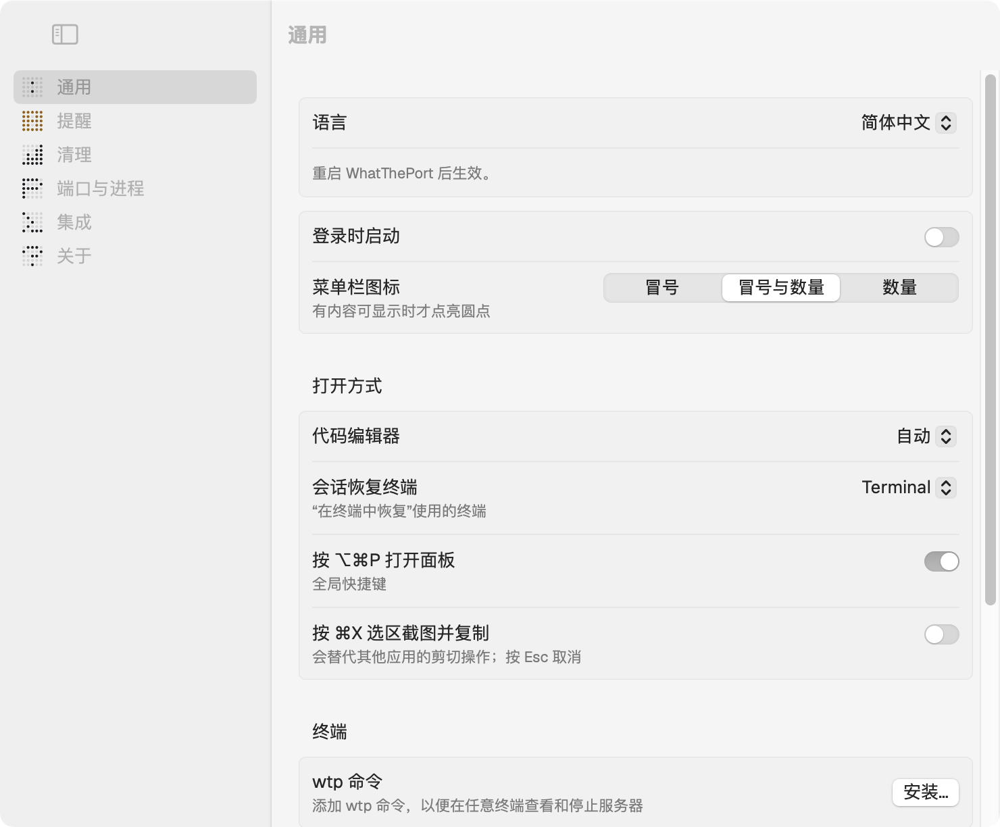
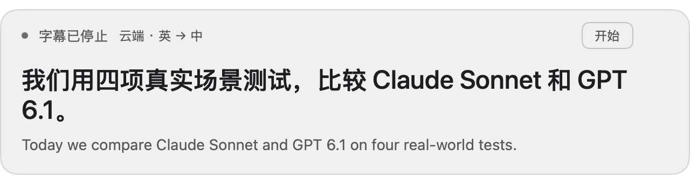

# WhatThePort 中文版

基于 [Tom John 的 WhatThePort](https://github.com/tomjohndesign/what-the-port) 的非官方派生版本，由 [yishu-ziyu](https://github.com/yishu-ziyu) 维护。

**当前提供中英双语的 Mac 开发服务监控；后续扩展到应用与开发服务的统一资源视图。** 应用管理扩展仍在规划，本次发行没有实现完整的应用管理功能。

[下载预发行版](https://github.com/yishu-ziyu/what-the-port/releases) · [路线图](ROADMAP.md) · [本地化说明](LOCALIZATION.md) · [原项目说明](UPSTREAM_README.md)

## 当前版本能做什么

- 在菜单栏查看开发服务的端口、项目、分支、内存和 CPU。
- 原生界面支持简体中文和 English，可跟随系统；切换后重启生效。
- 保留上游的会话关联、进程详情和清理功能，以及其他应用的内存汇总。
- 终端 `wtp` 和 JSON 输出保持英文；项目名、路径和命令保持原样。

## 开发中（`main` 分支，尚未发布）

以下改进已在源码中完成，会在下一个预发行版提供：

- 实时字幕：从“设置 → 通用 → 实时字幕”或菜单栏右键打开，采集电脑内部声音。可选本机 SenseVoice-Small 或阶跃 StepAudio 2.5 ASR；英语翻译使用 Step 3.7 Flash，走 Step Plan。原文与译文按段配对。新模型链路的安装版验收尚未通过，不能视为已交付功能。
- 应用内存页：点击“其他应用”，查看占内存最多的 5 个应用（辅助进程已并入所属应用）、进程数，以及与开发服务的对比。只展示，不提供关闭。
- 能识别 Homebrew Python 和带版本号的 Python（如 `python3.13`）启动的服务。
- 停止 Homebrew 服务（postgres、redis 等）改用 `brew services stop` 并先确认，不会停了又被系统拉起；Homebrew 服务显示服务名，不再显示 Homebrew 自己的分支。
- 停止某个工具启动的预览服务时，不会连带停止启动它的工具。
- 应用自身 CPU 占用从约 5% 降到约 1%，不再每 2 秒启动 `lsof`。



## 安装

从本仓库 [Releases](https://github.com/yishu-ziyu/what-the-port/releases) 下载 `WhatThePort-ZH-2.5.1-arm64.zip`，解压后把 `WhatThePort 中文版.app` 移入「应用程序」。启动后点击菜单栏图标，或按 **⌥⌘P**。

本次预发行要求 **Apple Silicon、macOS 14+**。应用使用本地 ad-hoc 签名，尚未经过 Developer ID 公证；macOS 可能要求在系统设置中确认来源。当前已在开发者的 Mac 上验证，尚未完成第二台 Mac 的安装验证。

本派生版使用独立应用标识，保留自己的设置，不使用官方自动更新源。暂时通过 Releases 手动更新。下载官方原版请访问 [上游网站](https://whattheport.dev)。

## 从源码构建

```sh
cd WhatThePort
swift test --jobs 4
./build-localized.sh
```

需要 Xcode/Swift 工具链，首次构建会下载 SwiftPM 依赖。产物为 `.build/WhatThePort.app`。发布包带有相关许可文本；本仓库不包含编译缓存或应用二进制。

## 与上游协作

`feature/simplified-chinese` 分支只承载通用中文支持，供上游 PR 审查。`main` 包含本派生版的发行说明、独立应用标识和未来功能。我们会继续同步适合的上游修复，也会将通用改进回馈上游。

## 来源与许可

原项目由 Tom John 创建，上游 README 声明 MIT。原说明完整保留在 [UPSTREAM_README.md](UPSTREAM_README.md)。本仓库保留原作者署名，并在 [NOTICE.md](NOTICE.md) 列出原项目与依赖许可来源。派生修改以 MIT 许可提供；见 [LICENSE](LICENSE)。

## 实时字幕（开发中，尚未发布）



上图使用固定文案展示排版，不代表新的识别或翻译结果。

选择识别模型和语音语言，点击“开始字幕”，按系统提示允许屏幕与系统音频录制，然后播放视频或音频。首次授权后可能需要重启应用。字幕按短音频段处理，不是逐字即时显示。紧凑浮窗只显示当前片段：中文译文在上，英语原文在下；翻译尚未返回时先显示原文。点击“回看”查看打开时的最近片段；点击字幕设置调整模型、语言和原文显示。运行中切换模型或语言需先停止。工具集中在顶部一排；回看、设置和关闭在悬停或键盘聚焦时出现。可选浅灰实底或透明字幕。窗口高度跟随当前内容，长段可滚动；可拖动、调整宽度并记住位置；关窗即停止采集与模型请求。

- 云端识别：使用 `stepaudio-2.5-asr`，音频发送至 `https://api.stepfun.com/step_plan/v1/audio/asr/sse`。只使用 Step Plan，不回退到按量接口或其他供应商。
- 本机识别：复用 `~/Downloads/项目与数据/agent_audio_funasr/` 中的 SenseVoice-Small 可执行文件、模型与 VAD。音频不发送给云端识别；临时 WAV 在识别后删除。不随应用分发模型，也不自动下载安装其他模型。
- 英语翻译：使用同一 Step Plan 的 `step-3.7-flash`。即使选择本机识别，英语文字仍会发送到云端翻译。中文原文模式不调用翻译。
- 凭据：从现有 `~/.config/ai-providers/env.local` 读取 `STEPFUN_API_KEY`；环境变量可覆盖。密钥不写入仓库或应用包。

不采集麦克风。云端音频仅保留在应用内存中，本机识别需要临时音频文件；不保存字幕文件。界面在启动前明确显示音频与文字的发送对象。权限、网络、模型和翻译错误会直接显示，不静默切换供应商。识别队列满时停止并提示，不静默丢弃片段。

本地 ad-hoc 签名的新版可能与旧授权签名不匹配。若开关开启仍被拒绝，应核对运行路径与 macOS 权限日志，再重新登记当前安装版的授权；不能仅凭开关状态判断权限可用。
